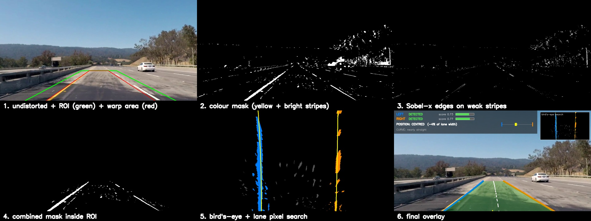
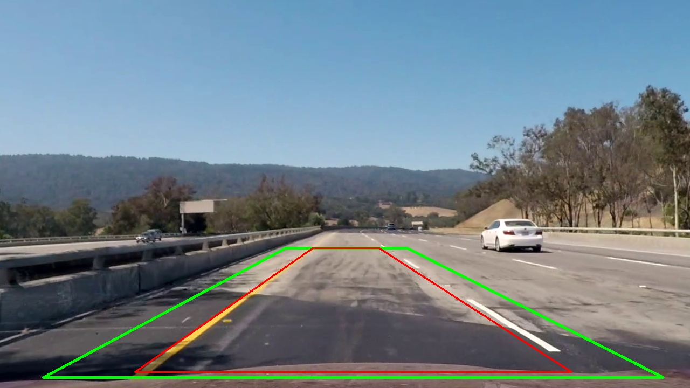
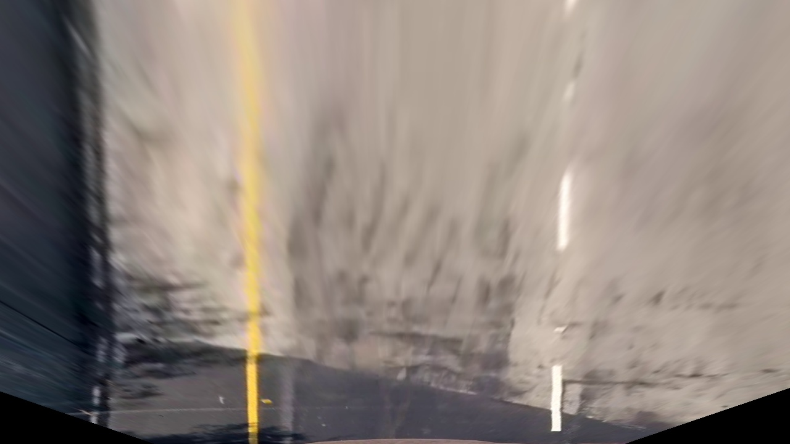
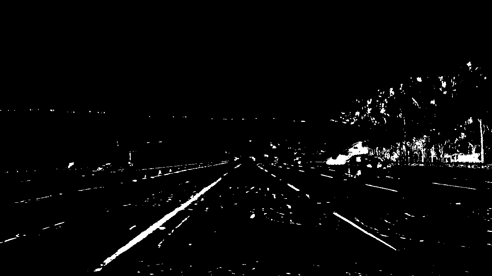
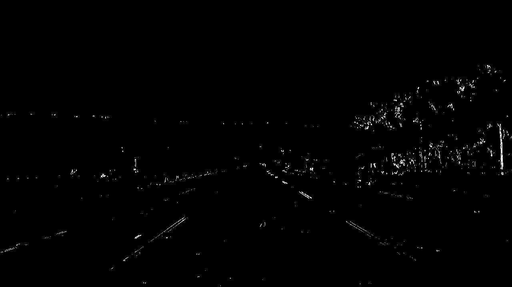
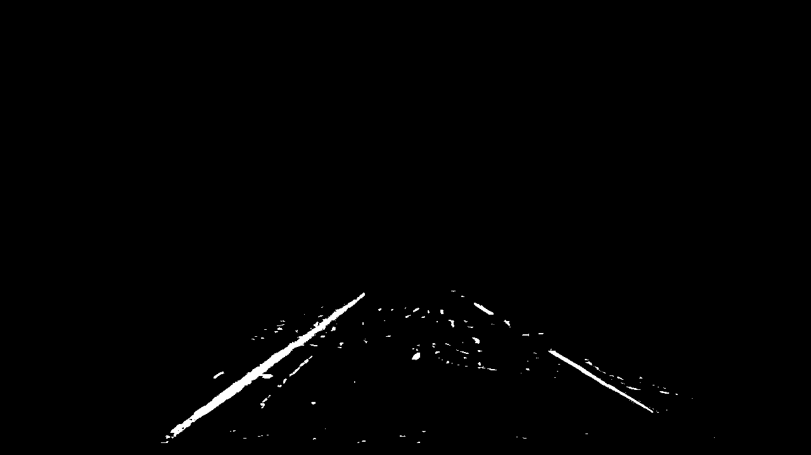
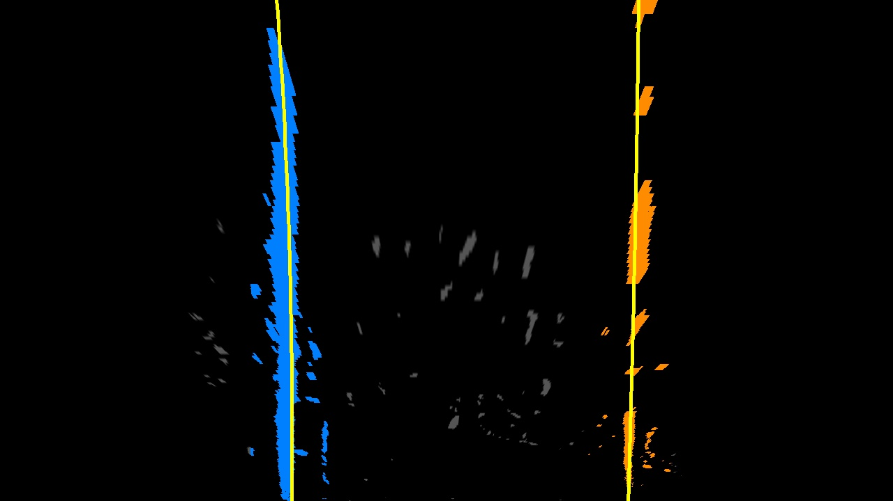
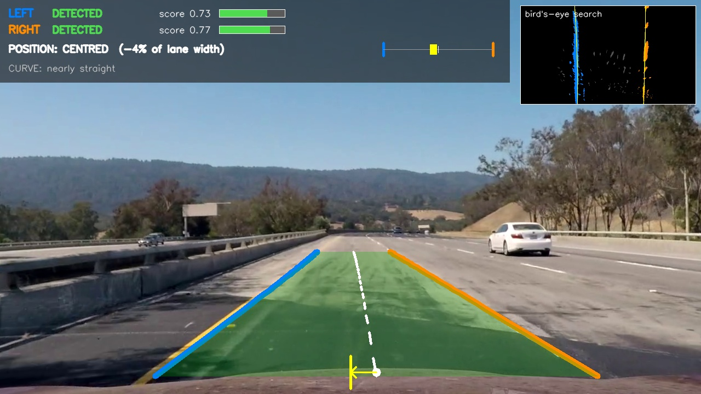

# Lane Keeping Assist – Video Analysis (Optional Homework)

This project is the perception part of a Lane Keeping Assist. It takes a forward-facing road video, finds the left and right boundary of the lane the car is driving in, and draws on every frame where the car sits inside that lane. It works offline on recorded video and does no vehicle control.

Everything uses classical image processing with OpenCV and NumPy. There is no neural network.

For a shorter step-by-step version with pictures (what was submitted, how to run it, results, ODD), see [docs/Submission_Guide.pdf](docs/Submission_Guide.pdf).



---

## 1. What is where

```
Optional_Assignment_Lane_Keeping_Assistant/
│
├── run_lka.py               main script: video in -> annotated video out
├── save_pipeline_steps.py   saves one picture per pipeline stage for a chosen moment
├── calibrate_camera.py      one-time camera calibration from the chessboard photos
│
├── settings.py              every tuned number (thresholds, warp points, limits)
├── image_processing.py      undistort, colour mask, edge mask, ROI, bird's-eye warp
├── lane_search.py           sliding-window search + polynomial fit for one boundary
├── lane_tracker.py          confidence score, plausibility checks, smoothing, holding
├── overlay.py               all the drawing (lines, lane area, info panel, inset)
├── pipeline.py              glues the steps together for one frame + diagnostic grid
│
├── camera_cal/              20 chessboard photos (from the Udacity repo)
├── camera_calibration.npz   result of calibrate_camera.py
├── videos/                  input videos (Udacity project / challenge / harder challenge)
├── output/                  full annotated + diagnostic videos (created by run_lka.py, not in git: too big)
├── clips/                   short clips picked for the submission (good + bad cases)
├── screenshots/             pipeline stage pictures (visual walkthrough) + result frames
├── docs/                    step-by-step submission guide (Word + PDF)
├── Submission/              the organised hand-in folder (local only, not in git)
└── requirements.txt
```

**Input footage:** the three videos from Udacity's
[CarND-Advanced-Lane-Lines](https://github.com/udacity/CarND-Advanced-Lane-Lines) repository, together with their camera calibration photos. The videos and calibration photos in `videos/` and `camera_cal/` come from that repository and are only included here so the code runs out of the box. All credit for the footage goes to Udacity.

| Video | Length | What it contains |
|---|---|---|
| `project_video.mp4` | 50 s | highway, yellow solid left line, white dashed right line, two light concrete bridges, tree shadows |
| `challenge_video.mp4` | 16 s | highway, dark/light asphalt seams, a crack along the lane, driving under a bridge, **different camera mount** |
| `harder_challenge_video.mp4` | 48 s | narrow mountain road, sharp hairpins, strong sun/shade changes, glare, double yellow centre line |

---

## 2. How to run it

### Step 0 – install (once)

You need Python 3.9 or newer.

```bash
pip install -r requirements.txt
```

ffmpeg is optional. It's only used to shrink the output videos (see step 4).

### Step 1 – camera calibration (once, already done)

```bash
python calibrate_camera.py
```

This finds the chessboard corners in `camera_cal/` and writes `camera_calibration.npz`. 17 of the 20 photos are usable. The other three cut off part of the board, so the corners aren't found and those photos are skipped. A before/after check image goes to `screenshots/00_calibration_check.jpg`.

### Step 2 – process a video

Run all commands from inside this folder.

```bash
# good case
python run_lka.py videos/project_video.mp4 --diagnostic

# challenge video: needs its own camera profile (see section 3.2)
python run_lka.py videos/challenge_video.mp4 --camera challenge --diagnostic

# limitations case
python run_lka.py videos/harder_challenge_video.mp4 --diagnostic
```

Options:

| Option | Meaning |
|---|---|
| `--diagnostic` | also writes `output/<name>_diagnostic.mp4`, a 3 x 2 grid of the pipeline stages |
| `--camera challenge` | use the camera profile for `challenge_video.mp4` (default is `default`) |
| `--start 18 --end 30` | only process this time range (seconds) |
| `--output path.mp4` | choose the output file name |

At the end the script prints how often each boundary was DETECTED / UNCERTAIN / HOLDING / LOST. That summary is handy for comparing settings.

Processing runs at roughly 5–7 frames per second on my laptop with the diagnostic video on. A 50-second clip takes about 3–4 minutes.

### Step 3 – pipeline screenshots for one moment

```bash
python save_pipeline_steps.py videos/project_video.mp4 --time 22
python save_pipeline_steps.py videos/challenge_video.mp4 --time 5 --camera challenge
python save_pipeline_steps.py videos/harder_challenge_video.mp4 --time 44
```

Each call writes nine stage pictures plus `all_stages.jpg` to `screenshots/<video>_<time>s/`. The harder-video set at 44 s shows the hairpin failure from section 5. `harder_challenge_video_4s/` is an extra set from early in that video, where detection still works.

### Step 4 (optional) – make the videos smaller / more compatible

OpenCV writes the videos with the `mp4v` codec. VLC and the Windows player play them fine, but the files are big and some browsers or PowerPoint refuse them. The files in `output/` and `clips/` have already been converted to H.264 with:

```bash
ffmpeg -i output/project_video_lka.mp4 -c:v libx264 -crf 23 -pix_fmt yuv420p output/project_video_lka_h264.mp4
```

---

## 3. How it works

One frame goes through these steps (`pipeline.py`, `LaneKeepingAssist.process`):

```
frame
  -> 1. undistort (camera calibration)
  -> 2. colour mask   (yellow paint  OR  thin bright stripe)
  -> 3. edge mask     (Sobel-x, only where there is at least a weak stripe)
  -> 4. combine, keep only the region of interest
  -> 5. warp to bird's-eye view
  -> 6. search left and right boundary pixels, fit x = a*y^2 + b*y + c
  -> 7. tracker: score, plausibility checks, smoothing, hold / drop
  -> 8. draw overlay
```

### 3.1 Undistortion

The camera lens bends straight lines, mostly near the image edges. `calibrate_camera.py` uses the chessboard photos and `cv2.calibrateCamera` to get the camera matrix and distortion coefficients. Every frame is then fixed with `cv2.undistort`. Without this step the bird's-eye view of a straight road would come out slightly curved.

### 3.2 Region of interest and bird's-eye view



* **Red trapezoid**: four points on the road that get mapped to a rectangle (`cv2.getPerspectiveTransform`). After warping, the lane looks as if seen from above, so its two lines are parallel and roughly vertical. I picked the points on a straight piece of `project_video.mp4` so that the lines come out vertical there.
* **Green trapezoid**: the region of interest. It is wider than the red one so the lines stay inside it when the car drifts or the road bends. Sky, trees, the far side of the road and other lanes are thrown away.

**Why there are two camera profiles.** At first `challenge_video.mp4` kept failing the "lines must be parallel" check. When I mapped the detected lines back into the camera image and intersected them, the vanishing point was about 45 px further right and 13 px lower than in `project_video.mp4`, and the lane looked narrower. So the challenge clip was filmed with a different camera mount, and the same trapezoid gave tilted, converging lines. I added a second set of points (`CAMERA_PROFILES["challenge"]` in `settings.py`). With it the left boundary on the challenge video went from about 44 % to 95 % of frames detected. In a real car this would be fixed once per vehicle by extrinsic calibration.



### 3.3 Finding paint pixels (colour + edges)

| Colour mask | Edge mask | Combined in ROI |
|---|---|---|
|  |  |  |

**Yellow:** an HSV range (hue 15–35, saturation ≥ 80, value ≥ 110).

**White (and any other bright paint): the "stripe test".** This took me three tries, and the reasoning matters for the ODD discussion:

1. *Fixed brightness threshold* (HLS lightness > 200): fine on dark asphalt, but on the light concrete bridges in `project_video` the whole road passed it.
2. *Brighter than the local average* (lightness minus a 41 x 41 blur): fixed the bridges, but it also fired on the sunlit face of concrete barriers and along shadow borders. On the challenge video the left boundary picked up 15 000–50 000 noise pixels next to the barrier.
3. *Stripe test (what I use now)*: lane paint is a thin bright stripe, so a paint pixel is brighter than the road **12 px to its left and 12 px to its right at the same time**. A barrier or shadow border is only brighter on one side, so it fails. It's a few lines of NumPy (`np.roll` shifts the image sideways, `image_processing.stripe_mask`). The noise on the challenge video dropped, and the median fit error went from about 25 px to about 7 px.

**Edges:** Sobel in x direction on the lightness channel, since lane lines are close to vertical in the image. Used alone, Sobel lit up every shadow edge, tree and tar seam, so an edge pixel only counts if it also passes a much weaker stripe test (contrast 5 instead of 15). That way the edges add back some faded paint without bringing the shadows with them.

Everything outside the green ROI is then set to black.

### 3.4 Searching for the two boundaries (`lane_search.py`)



There are two ways to search, depending on what we already know:

* **Sliding windows** (no history): count the white pixels per column in the lower half of the bird's-eye mask. The highest peak left of the centre is the start of the left line, and the highest peak right of the centre starts the right line. I only look within one lane width of the centre so the next lane's marking isn't picked. From there, 9 stacked windows (140 px wide) climb up the image. A window that holds more than 40 pixels moves the next window to their mean x. In a gap between dashes, the windows just keep going straight up. Windows are drawn green in the search view.
* **Search around the previous curve** (normal case): take every pixel within ±60 px of last frame's smoothed curve. This is faster and doesn't jump to a different marking. If the band is nearly empty, the code falls back to windows, starting at the bottom of the old curve rather than at the histogram peak.

The pixels are then fitted with a 2nd-order polynomial **x = a·y² + b·y + c** (`np.polyfit`). x is written as a function of y because in the bird's-eye view each row has exactly one x per line.

### 3.5 Deciding what to believe (`lane_tracker.py`)

This is where uncertainty gets handled. Each new fit goes through three steps.

**Step 1 – score each side on its own.** The confidence score is the plain average of four parts, each between 0 and 1:

| Part | Full marks when… | Why |
|---|---|---|
| pixels | ≥ 2000 supporting pixels | more evidence |
| coverage | pixels spread over ≥ 70 % of the image height | a line seen only near the bottom gives a wild curve further up |
| fit | small RMS distance of pixels to the curve (0 at 15 px) | clean line vs scattered noise |
| consistency | close to the smoothed curve of recent frames (0 at 70 px average shift) | lines don't teleport between frames |

A new fit is **rejected** if its score is below 0.35 or if it moved more than 70 px from the recent curve ("jumped").

> This is a heuristic quality score, **not a probability**. I haven't calibrated it against ground truth, so "0.8" doesn't mean "80 % chance of being right".

**Step 2 – check both sides together.** The two curves have to look like one lane:
* they must not cross,
* the lane width at the bottom must be 330–640 px (the expected value is 480 px),
* top and bottom widths may differ by at most 160 px (roughly parallel).

If the pair fails, the weaker new side is dropped. If only one side is new, it's checked against the other side's held curve, and it's dropped if they don't fit together. This rule is what stops the overlay from sliding onto a neighbouring marking.

**Step 3 – update each boundary's state:**

| State | When | How it is drawn |
|---|---|---|
| **DETECTED** | fresh fit, accepted, score ≥ 0.60 | thick solid line |
| **UNCERTAIN** | fresh fit, accepted, score 0.35–0.60 | thin solid line |
| **HOLDING (n)** | no usable fit this frame, old curve kept for up to 12 frames (~0.5 s) | **dashed, greyed** line; the score fades ×0.8 per frame and the reason is shown |
| **LOST** | held longer than 12 frames | not drawn; history cleared so the next search starts fresh |

Accepted fits are **smoothed** by averaging the polynomial coefficients of the last 6 accepted fits. A held curve never counts as a new detection: its line style changes, its score fades, and the position text gets the label "uncertain".

### 3.6 Vehicle position and curvature

* The camera sits in the middle of the car and the bird's-eye view is symmetric about the image centre, so the **car centre** is the middle column at the bottom of the image.
* **Lane centre** = midpoint between the two boundaries at the bottom row.
* **Offset** = (car centre − lane centre) / lane width. It's a fraction of the lane width, so no metres are needed. 0 means centred, and ±0.5 means the car centre sits on a line.

| abs(offset) | Text |
|---|---|
| < 0.08 | CENTRED |
| 0.08 – 0.20 | SHIFTED LEFT / RIGHT |
| ≥ 0.20 | CLOSE TO LEFT / RIGHT LINE (red) |

A typical car is about half as wide as a lane, so at an offset of ±0.25 its side is already about on the line. That's why "close" starts at 0.20.

The position is only computed when both boundaries are visible. If one of them is only held, the text says "uncertain". If one is LOST, it says "POSITION: unknown".

**Curve radius:** R = (1 + x′²)^1.5 / |x″| on the lane-centre curve, after converting pixels to metres with a **rough guess** (480 px ≈ 3.7 m lane, 720 px ≈ 30 m ahead). It's only meant to show the order of magnitude and the direction. Above 2500 m it shows "nearly straight". On `project_video` it reports roughly 650–1000 m in the bends, which is plausible for a highway curve, but the number jumps around a lot because a small change in the 2nd-order term changes the radius a lot.

### 3.7 What the overlay shows



* **Blue line** = left boundary, **orange line** = right boundary (solid / thin / dashed-grey as above)
* **Green lane area** when both are DETECTED, **amber** when either one is uncertain or held
* **Dashed white line** = estimated lane centre
* **Yellow bar at the bottom** = car centre, **white dot** = lane centre, arrow = offset
* **Info panel** (top left): state + score + score bar for each boundary, the reason when a boundary is not fresh (`jumped`, `not parallel`, `lane width`, `lines cross`, `too few pixels`, `low score`), position text with offset in % of lane width, a small lane diagram with the car, and the rough curve radius
* **Inset** (top right): the bird's-eye search, with left pixels in blue, right pixels in orange, windows in green and curves in yellow (dashed when held)

---

## 4. Results

Share of frames in each state (printed by `run_lka.py`):

| Video | Left boundary | Right boundary |
|---|---|---|
| project_video | DETECTED 100 % | DETECTED 100 % |
| challenge_video (`--camera challenge`) | DETECTED 95 %, HOLDING 5 % | DETECTED 98 %, HOLDING 2 % |
| harder_challenge_video | DETECTED 44 %, UNCERTAIN 6 %, HOLDING 33 %, LOST 18 % | DETECTED 54 %, UNCERTAIN 3 %, HOLDING 31 %, LOST 12 % |

These numbers say how often the system *thinks* it has a line. They don't say how often it's right. I checked correctness by watching the videos, and section 5 lists the cases where it is confidently wrong.

### Submission clips (`clips/`)

| Clip | What it shows |
|---|---|
| `01_good_project_concrete_and_shadows.mp4` (+ `01b_..._diagnostic`) | project_video 18–30 s: light concrete bridge, then tree shadows. Both lines stay DETECTED and the overlay doesn't flicker |
| `02_ok_challenge_bridge_shadow_and_seams.mp4` (+ `02b_..._diagnostic`) | whole challenge video: asphalt colour seams and a crack running along the lane are ignored; under the bridge the left line briefly goes to HOLDING and comes back |
| `03_limit_harder_glare.mp4` | harder video 18–27 s: sun glare washes out the left side, which goes to HOLDING (dashed grey), and the position turns amber "uncertain" |
| `04_limit_harder_hairpin_wrong_marking.mp4` (+ `04b_..._diagnostic`) | harder video 39–48 s: hairpin bends. The left line is LOST, the position shows "unknown", and the right boundary jumps onto the yellow centre line **while still claiming DETECTED** (failure case) |

The full-length videos are written to `output/` when you run the commands in section 2. They aren't in the git repository because they're too big.

---

## 5. Operational Design Domain (where it works and where it doesn't)

### Works well

* **Highways and main roads with clear painted lines**, solid or dashed, yellow or white. Dashes are no problem: the windows carry on through the gaps and the 2nd-order fit bridges them.
* **Light concrete or patched road surfaces.** The stripe test only looks at relative brightness, so a bright road doesn't flood the mask.
* **Moderate shadows** from trees and bridges, as long as the paint stays visible on at least part of the line.
* **Asphalt colour seams, cracks and tar lines** inside the lane. They're either darker than the road or a step rather than a stripe, so the stripe test rejects them.
* **Gentle curves** (radius of several hundred metres or more) that stay inside the region of interest.
* **Short dropouts** (up to ~0.5 s): the old line is held but clearly marked, then dropped.

### Weak or failing

* **Sharp curves and hairpins.** The lines leave the trapezoid region of interest, or curve so strongly that the "parallel" and "lane width" checks reject them. The overlay goes to HOLDING/LOST, which is the right thing to do, but there is no useful output there.
* **Strong glare and fast light changes** (sun straight ahead, coming out of the forest). The camera washes out, paint contrast disappears, and the stripe test finds nothing.
* **Hard shadow patterns** (sun through trees) on a road with weak paint. Small bright spots between shadows look like stripes.
* **Ambiguous markings.** On the harder video the right boundary sometimes snaps onto the double yellow centre line or the road edge with a *high* score. The score only measures how line-like the pixels are. It can't tell whether a marking is the correct one. This is the most important limitation: a confident wrong answer is worse than an honest "LOST".
* **Different camera mounting.** The warp points depend on camera height and pitch (the challenge video needed its own profile). Hills change the pitch too, so on steep crests and dips the bird's-eye view stops showing parallel lines.
* **Lane changes.** The car crossing a line isn't modelled. The tracker holds the old lane, rejects the new one for "jumped", drops everything after 0.5 s and then searches again from scratch. It recovers, but there is about half a second with no confident lane.
* **Not tested at all:** night, rain/wet roads with reflections, tunnels, snow, roads without markings, intersections, exits and merges. I'd expect wet-road reflections in particular to pass the stripe test, because they are bright streaks on dark ground.

### How the overlay behaves when the lane isn't clear

The system degrades in steps instead of guessing: solid line → thin line (UNCERTAIN) → dashed grey line with a fading score and a reason (HOLDING) → nothing (LOST). The lane area turns from green to amber as soon as either side isn't a fresh, good detection. The position text first gets the label "uncertain" and then changes to "unknown". A held position never looks like a new detection.

---

## 6. Possible improvements

* **Lane width memory:** when one side is lost, estimate it from the other side plus the last known lane width, and draw it as "ESTIMATED".
* **Adaptive region of interest** that follows the curve from the previous frame, so hairpins don't run out of the trapezoid.
* **Marking type check:** reject a double yellow line when we expect a single white edge line (count the parallel stripes and check their colour).
* **Score calibration:** label a few hundred frames by hand and map the score to a real probability.
* **Line width check** for the stripe test (paint is 10–15 cm wide), to reject wet-road reflections and sun spots.
* **Speed:** compute the undistortion maps once with `cv2.initUndistortRectifyMap` and use `cv2.remap`. Right now `cv2.undistort` recomputes them on every frame.

---

## 7. Changing the tuning

All numbers are in `settings.py`, grouped and commented: warp and ROI points per camera, colour / stripe / Sobel thresholds, window search sizes, plausibility limits, score weights, smoothing length, hold time and position limits. Change a value, rerun `run_lka.py`, and compare the state summary printed at the end.

To try your own video: if it isn't 1280 x 720 it gets resized. You'll most likely need a new camera profile, so pick four points on a straight piece of road that form a trapezoid around your lane, add them to `CAMERA_PROFILES`, and add the name to the `--camera` choices in `run_lka.py` and `save_pipeline_steps.py`. The Udacity calibration only fits the Udacity camera. For other footage, either skip the undistortion or calibrate your own camera with chessboard photos.
